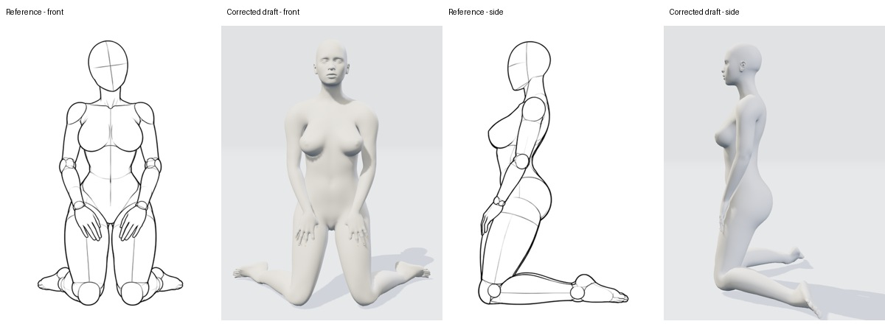

# makehuman-v3：正面与侧面草稿核对

这份记录检查的是 **24 个已有的手工 3D 预设草稿**，不是对 288 组图库完成了 3D 转换。对每组，把同一工作台姿势切到 `f` / `s` 两个相机，与图库对应视角逐项比较；正、侧视均有原图。截图于 2026-10-29 使用成人模型 `makehuman-v3`、真实工作台 API、无头浏览器、900 × 1200 像素，WebGL2；采集前预设文件 SHA-256 为 `d55f2d0a842c362c9672af4463614497268447334084978b187d19ee940a56f5`。场景和逐组采集记录保留在本机 `output/model-research/v3-audit/`。采集期间编辑器应用代码有并行改动，部分会话没有记录其精确载入哈希；截图是当时的基线，代码或预设更新后必须重新渲染，不能视为新版验收。

工作台的 `f` / `s` 是固定世界方向，**尚未为每张参考图标定**。有些侧面参考人物朝右而模型朝左；画面裁切、人物前后遮挡或参考线稿侧别不明时，不能仅凭截图判断隐藏侧的关节、手掌法线和脚底方向。凡无法观察到的部位均写明“看不清”，不能当作正确。以下均需进一步修正、重新渲染和人工审核，**没有一项通过准确重建验收**。

## 两个本地拟合草稿

[正面、侧面与原图对照](pose-review-v3/local-fit.jpg)。这两行是本机算法拟合草稿，区别于下方手工预设；侧面是同一 3D 人物换相机查看，**不是多视图联合拟合**。

- `solo_kneel_hands-thighs`：参考侧面躯干近直立，膝、胫、脚背贴地，双手扶腿。拟合结果全身后倒、头随之仰起，双手落在身体后侧，膝部抬起、脚趾触地；均与参考不符。单个 2D 点不能说明掌心和脚底的转向。
- `solo_stand_arms-up-stretch`：举手动作可辨认，但正面身体/头有偏转、手指张开，掌向与并指参考不同；侧面双臂前后位置不重合。当前结果没有人工验证手掌方向或多视图一致性。

## 跪姿预设后续调整

下方表格和对照图保留修正前基线。`solo_kneel_hands-thighs` 已在该次检查后人工调整：[修正后的正面和侧面对照](pose-review-v3/kneel-corrected.jpg)。小腿更接近水平、双脚在正面可见、躯干较直，手更靠近大腿；掌面接触、手指间距、脚趾方向和远侧脚贴地仍需修正。未使用该预设覆盖本地单视图拟合草稿，也未通过验收。

## 跪姿、深蹲和卧姿

| 预设 | 头、躯干和正侧轮廓 | 手的方向与接触 | 脚的方向与支撑 | 对照 |
|---|---|---|---|---|
| `solo_kneel_hands-thighs` | 预设侧面躯干较直立，但与参考的跪姿支撑仍不同。头颈与参考轮廓不同，不能精确判断视线。 | 左右手垂在大腿外侧，未放在大腿前面；掌面方向缺乏证据。 | 两膝接近地面，小腿向后上抬、脚背悬空；参考小腿和脚背贴地。 | [原图与预设](pose-review-v3/contact-manual-1.jpg) |
| `solo_stand_arms-up-stretch` | 双臂上举可辨认；侧面参考有向后伸展的躯干弧线，预设较直。 | 左右手手指张开，手掌方向和并指伸直的参考不一致；侧视手臂/手掌重合关系不同。 | 双脚大致着地，但站距和脚尖位置仍需校对；侧视远侧脚部分重叠。 | [对照](pose-review-v3/contact-manual-1.jpg) |
| `solo_kneel_arms-up` | 参考侧面胸背后伸、头后仰；预设躯干和头较直。 | 双臂上举，但左右手指张开，未形成参考的并指直掌。 | 两小腿向后上抬、脚悬空，参考小腿与脚背贴地。 | [对照](pose-review-v3/contact-manual-2.jpg) |
| `solo_kneel_one-kn-hand-kn` | 参考身体朝高膝略前倾、头向下；预设躯干和头更直，支撑位置不同。 | 参考双手叠在抬起的膝上；预设一手向前悬空、另一手下垂，均未放在膝盖。 | 参考前脚足底、后小腿与脚背贴地；预设前脚抬起、后脚悬空，触地关系不同。 | [对照](pose-review-v3/contact-manual-2.jpg) |
| `solo_squat_hands-kns` | 参考侧面更直立且头略仰，预设头略低、身体前倾；正面双膝间距也不同。 | 参考左右手分别扶膝，预设双手悬在膝外侧，手掌未接触膝部。 | 参考双脚着地、脚跟落地；预设以脚尖附近触地、脚跟明显抬起。 | [对照](pose-review-v3/contact-manual-3.jpg) |
| `solo_lie_supine-arms-up` | 固定正面相机看向身体端部，主体严重透视压缩；侧视有身体横向裁切，不能据此判断被遮挡的头颈细节。 | 参考正面双肘弯曲、双手位于头两侧；预设正面大多被身体遮挡、侧面手部超出画面，无法验收手向与接触。 | 预设侧面脚部部分裁切，正面两脚朝向参考差异可见但脚底细节无法完整判断；躯干与地面接触还需检查。 | [对照](pose-review-v3/contact-manual-3.jpg) |
| `solo_lie_side-chin` | 参考头部由支撑臂托起、双腿靠拢并略弯；预设正面身体拉直且裁切，侧面相机几乎沿身体轴观察，无法与侧图直接比轮廓。 | 参考手托头、另一手扶髋；预设前臂/手没有形成对应接触。侧视遮挡严重，掌面不能判断。 | 参考双腿靠拢；预设正面双腿更直且间距不同，脚部超出画面，脚底角度无法判断。 | [对照](pose-review-v3/contact-manual-4.jpg) |
| `solo_lie_prone-arm-pillow` | 参考俯卧、头和躯干靠近地面；预设侧面身体中段有明显间隙，头和肢体被裁切，需重设相机后复核。 | 参考双前臂交叠托头；预设双前臂及手向上抬起，没有形成托头接触。 | 参考双腿与脚向后放置；预设侧面足端裁切且脚尖向下，完整脚底朝向不可判。 | [对照](pose-review-v3/contact-manual-4.jpg) |

## 站姿和坐姿

| ID | 头部和侧面躯干 | 双手 / 手掌 | 双脚及接触 | 对照 |
|---|---|---|---|---|
| solo_stand_contrapposto-hip | 原侧图面向画面右侧，当前侧视面向左侧；未校准相机，不宜仅凭此推断头部错误。原图重心明显偏到一侧，当前侧视近直立。 | 正面图参考是画面左手叉腰，模型变成画面右手，且手在大腿外侧而非腰上；另一只手垂下。掌面及指尖朝向细节无法确认。 | 原图一腿伸一腿屈、双脚方向不一致；模型两腿更直且明显分开，脚方向及受力分配不符；侧视后侧脚部分遮挡。 | [对照](pose-review-v3/solo_stand_contrapposto-hip.comparison.jpg) |
| solo_stand_hands-hips | 参考头部轻倾，当前头部较正；侧图参考脊柱略拱、髋后移，模型趋于直立。 | 两手应同时叉在腰两侧且手肘外开，模型双手落在髋下/上大腿，手掌没有触腰。侧视另一手遮挡，掌面细节未能判断。 | 参考侧图前后脚有位移且一膝屈曲，模型两腿近直，双脚几乎重叠；正面两脚间距与参考不同。单凭缩略图不能核准脚底方向。 | [对照](pose-review-v3/solo_stand_hands-hips.comparison.jpg) |
| solo_stand_look-bk | 正面参考头部侧倾且身体有扭动，模型头向画面右侧转动，躯干与头转向关系不符；侧视参考呈回头/身体弧线，模型接近直立。 | 参考双手下垂，模型也下垂但有手臂侧向位置差异。两个掌面的旋转与指尖细节无足够像素或被遮挡，不能认定。 | 参考一条腿伸向侧边、一膝微弯；模型前后开步较明显，侧面脚尖朝向和前后位置也不同；接触细节仍需放大检查。 | [对照](pose-review-v3/solo_stand_look-bk.comparison.jpg) |
| solo_stand_hands-hair | 侧图参考双肘、双手在头顶后方，模型双肘在胸前且手在颈侧；参考有轻微挺胸曲线。模型头部与参考的侧向轮廓不同。 | 左右手都应贴于头顶/后脑，模型均停在下颌和颈前；手指接触与掌面朝向没有重现。侧图一只手被遮挡，无法精确判定其原掌面。 | 参考正面双脚分开着地，当前大致站立但间距和脚尖朝向仍不同；侧面两脚重叠且远侧脚遮挡，不能确定完整脚底角度。 | [对照](pose-review-v3/solo_stand_hands-hair.comparison.jpg) |
| solo_sit_lean-bk-kn-up | 参考靠后坐且头略仰，模型躯干后仰程度近似但臀部悬空，整体支撑关系不同。 | 参考画面右手放在抬起的膝盖，模型该手举在肩前；另一手应撑地，模型手与地面接触不清楚且没有重现稳定支撑。手掌法线不可见。 | 参考一脚贴地、另一腿向前伸且脚朝上；模型一脚高举、另一脚更靠身体，侧面伸腿水平悬空，脚底方向与地面接触明显不符。 | [对照](pose-review-v3/solo_sit_lean-bk-kn-up.comparison.jpg) |
| solo_sit_hands-bk-chest-up | 参考臀部落地、双腿向前，模型臀部与双脚抬起并形成类似悬空 V 字；侧面轮廓差异尤其大。参考仰头，模型也仰头，精确角度不宜凭轮廓断言。 | 参考双掌在身后撑地；模型两臂向后，但侧图只有近侧手看起来接近地面，远侧手被遮挡，接触及掌朝向无法确认。 | 参考双腿向前贴地、双脚并拢，模型双足高举、脚掌朝镜头/上方，明显不符；脚底滚转不能从遮挡侧核准。 | [对照](pose-review-v3/solo_sit_hands-bk-chest-up.comparison.jpg) |
| solo_sit_kn-up-chin | 参考侧面上身靠向高膝，头侧靠在手上；模型上身较竖且臀部悬起，头部与膝距离过大。 | 参考一掌托脸、肘靠抬膝，另一掌撑地；模型托脸手停在嘴前，未见肘靠膝，支撑手及掌面被遮挡。 | 参考抬膝脚与前伸脚都贴地；模型前伸脚悬起，脚尖上翘，另一脚位置和方向需校正。 | [对照](pose-review-v3/solo_sit_kn-up-chin.comparison.jpg) |
| solo_sit_kn-up-hands-hd | 参考背部微弯坐地、双膝并拢向前，模型臀部悬空且躯干较竖；头部参考朝前略低，模型抬头。 | 参考左右手放在后脑、双肘向外；模型两手停在下巴和颈前，双肘位置明显偏低，掌面/手指未形成头部接触。 | 参考双脚并拢贴地、双膝并拢；模型双腿一伸一屈，一脚悬起，脚尖朝向和底部接触均不符。 | [对照](pose-review-v3/solo_sit_kn-up-hands-hd.comparison.jpg) |

## 弯腰、扭转和 W 坐

| ID | 头与躯干 | 双手 | 双脚及接触 | 对照 |
|---|---|---|---|---|
| solo_bend_hands-kns | 侧面身体整体斜向前倾，躯干和腿几乎连成直线，参考为髋部折叠；头随躯干向下，精确角度待镜头标定 | 草稿双手垂在大腿侧，未扶双膝 | 侧面可见脚跟抬起、脚尖附近触地；参考双脚平放 | [对照](pose-review-v3/solo_bend_hands-kns.comparison.jpg) |
| solo_twist_stand-arms-out | 双臂展开，头有转向；侧面相机未标定，不能仅据朝向差判错 | 两腕下垂，手指不像参考充分展开；掌面方向需要近视图复核 | 两脚有间距，接近地面；脚尖朝向和足底接触待逐个复核 | [对照](pose-review-v3/solo_twist_stand-arms-out.comparison.jpg) |
| solo_side-sit_w-sit-hands-fw | 头大体朝前；侧面身体、膝和小腿折叠关系与参考不同 | 双手陷在腿侧/腿下，未像参考向前伸出撑地；掌面被遮挡 | 参考小腿向后落地；草稿一只脚伸向前方，遮挡脚底不可判断 | [对照](pose-review-v3/solo_side-sit_w-sit-hands-fw.comparison.jpg) |
| sexy_sit_w-sit-hands-fw | 草稿头侧倾较弱，实际差值需先标定相机 | 双手被大腿遮挡，未见参考双掌在身前并拢撑地；掌面无法判断 | 两腿脚方向、膝脚支撑关系与参考不同；被遮挡足底无法判断 | [对照](pose-review-v3/sexy_sit_w-sit-hands-fw.comparison.jpg) |

## 上半身和双人

| ID | 头与躯干 | 双手 | 双脚及接触 | 对照 |
|---|---|---|---|---|
| upper_cute_salute | 头部大体正向；侧面轮廓仍需在相同镜头下判断 | 举起的手停在下巴附近，另一手垂下；参考手指并拢置额前、另一手扶腰 | 参考为上半身裁切，脚不可见，无法判断 | [对照](pose-review-v3/upper_cute_salute.comparison.jpg) |
| upper_cute_heart-over-hd | 头部大体正向；正面能辨认头顶弧形双臂，侧面双臂与头部前后关系不同，但视角未标定 | 双手抬至头顶，指尖重叠、手掌与指形欠准；参考指尖相接 | 参考为上半身裁切，脚不可见，无法判断 | [对照](pose-review-v3/upper_cute_heart-over-hd.comparison.jpg) |
| upper_cute_palms-together | 草稿头部接近直立；正面参考头部侧倾 | 草稿双手在胸下横向叠放，未如参考双掌竖直合于鼻前 | 参考为上半身裁切，脚不可见，无法判断 | [对照](pose-review-v3/upper_cute_palms-together.comparison.jpg) |
| duo_stand-close_whisper-cheek | 草稿两人分离，头部方向与身体接触未形成参考的亲近关系；侧面相机角度和遮挡差异待标定 | 女方手未贴男方脸，男方手未落在女方腰侧；部分掌面被遮挡 | 参考侧面女方一脚抬跟，草稿未再现；男方脚底与地面的精确接触待复核 | [对照](pose-review-v3/duo_stand-close_whisper-cheek.comparison.jpg) |

## 2026-10-29 掌面与膝/脚接触复核

“双手扶腿”正面、侧面现在使用同一套修正后的关节，只切换镜头。手掌朝向大腿，调整腿部倾角、膝盖屈曲、脚部转向和手腕；原先采样遗漏蒙皮凸起导致的脚部约 6 厘米悬空已修正。整张实际网格复核：两脚最低点离地约 3–3.5 毫米，两侧小腿/膝部约 4–5 毫米，与工作台保留的 3 毫米地面间隙接近。掌面采样与大腿表面间距约 4 毫米。

[数值复核记录](pose-review-v3/kneel-contact-review.json)。这些数据只验证当前网格的接触和共享姿势；**不是原图的准确三维还原**。体型比例、手指轮廓和部分投影仍有偏差，五视角的重投影质量门未全部通过，`verified` 仍为 `false`。脚部调整目前以脚踝控制整只脚，尚未增加独立脚趾骨。

全量转换队列按姿势分组，保留原始关键点、可见点人工估计、多视角草稿和失败原因。所有未经复核的批处理结果留在本机 `output/`；本次公开更新的是工具和这一个手工预设的接触修正。
