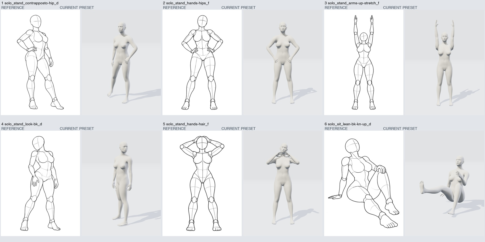
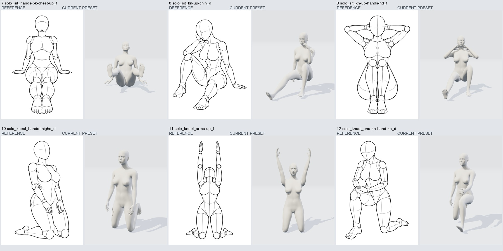
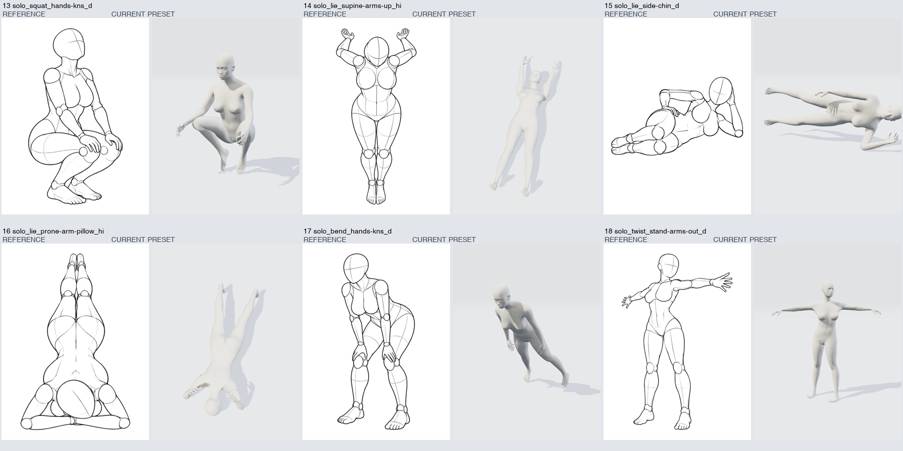
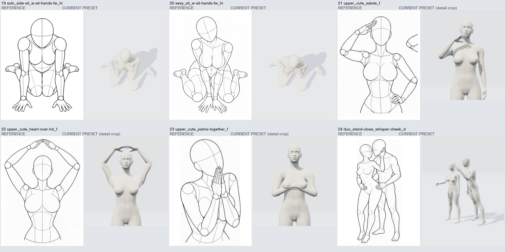

# 现有 24 个预设：原图与渲染目测核对

全部保留 `draft-needs-review`。本次为代理逐图目测，不是精确人工关键点标注或准确率测试。最终联系表由同一无头浏览器会话、MakeHuman v2、WebGL2、900×1200 串行导出；两个抬臂动作另检查 f/d/s。

## 结论

24 组中 20 组存在明显动作/接触/取景偏差（major），4 组主动作可辨认但仍有差异（minor）。没有一组可据此标为准确重建。

| 预设 | 等级 | 可见问题 |
| --- | --- | --- |
| solo_stand_contrapposto-hip | major | 扶髋的手侧与参考相反；手落在髋下而非腰侧。 重心、髋部倾斜和双腿一伸一曲的关系未匹配。 |
| solo_stand_hands-hips | major | 双手落在上大腿/髋下，未形成参考的叉腰接触。 双肘偏低，脚尖方向和站距未匹配。 |
| solo_stand_arms-up-stretch | minor | 本轮已把双臂收窄并接近伸直，主动作可辨认。 手指仍张开，未形成参考的并指直掌；头颈后仰、腰背弧线和比例尚未精确匹配。 |
| solo_stand_look-bk | major | 头、胸和骨盆的朝向关系与参考不一致。 参考的一侧屈膝、另一侧承重及髋部偏移未重现。 |
| solo_stand_hands-hair | major | 双手停在下巴/颈前，未放在头顶或后脑。 双肘高度和外展不足，动作语义与参考不一致。 |
| solo_sit_lean-bk-kn-up | major | 一条腿明显悬举，另一条腿接近竖直，与参考一膝抬起、另一腿向前放置不同。 上方手未落在膝盖，支撑手和臀部着地关系未解决。 |
| solo_sit_hands-bk-chest-up | major | 双脚抬在空中、膝部上收，参考为双腿向前放置。 双掌后撑和臀部落地的接触关系未重现。 |
| solo_sit_kn-up-chin | major | 手靠近脸但未形成手托下巴、肘靠膝的接触。 抬膝和另一条腿的位置、坐地支撑关系与参考不一致。 |
| solo_sit_kn-up-hands-hd | major | 双手在颈前，未置于后脑。 双膝一高一低、脚部散开，参考为双膝并拢抬起。 |
| solo_kneel_hands-thighs | major | 双手悬在大腿两侧，未贴放在大腿上。 小腿/脚部收放和身体俯仰未匹配，需核对膝、胫与地面接触。 |
| solo_kneel_arms-up | minor | 跪姿举臂的大方向与参考接近。 手臂间距、并指手型、脚踝折叠及小腿贴地关系仍需校正。 |
| solo_kneel_one-kn-hand-kn | major | 手停在腹部，未落到抬起的膝上。 单膝跪地、前脚落地及躯干前倾的组合未匹配。 |
| solo_squat_hands-kns | major | 双脚/脚跟悬起，未形成参考的稳定深蹲。 髋膝方向和双掌扶膝接触不对。 |
| solo_lie_supine-arms-up | major | 双臂伸直举过头，参考为双肘弯曲、手在头两侧。 腿部间距、俯视镜头和身体落地关系未匹配。 |
| solo_lie_side-chin | major | 人物头部贴近画面右边并发生裁切，镜头取景不合参考。 双腿接近伸直且张开，未收拢弯曲；手托头与另一手扶髋接触不对。 |
| solo_lie_prone-arm-pillow | major | 双前臂和双手未在头下组成枕臂接触。 腿部间距及镜头俯视方向不合参考，需校正躯干/肢体落地。 |
| solo_bend_hands-kns | major | 身体整体向前倾倒、腿随根节点倾斜，参考主要是在髋部折叠。 双掌没有扶膝，脚部支撑与头颈方向不对。 |
| solo_twist_stand-arms-out | minor | 站立展开双臂的主动作可辨认。 肩线、胸骨盆扭转、手掌朝向和重心偏移与参考仍有差异。 |
| solo_side-sit_w-sit-hands-fw | major | 双臂/手陷在身体附近，未向前伸展并撑地。 W 坐的髋膝脚相对位置及镜头俯角与参考不匹配。 |
| sexy_sit_w-sit-hands-fw | major | 双臂/手陷在躯干附近，未在身体前方并拢撑地。 腿部 W 形和膝部位置不一致，俯视镜头过陡。 |
| upper_cute_salute | major | 抬起的手在下巴前，未放到额侧敬礼。 另一手没有叉腰；肘部高度和掌向均不匹配。 |
| upper_cute_heart-over-hd | minor | 本轮已把额前手势改为头顶双手相接，三个视角均检查。 指尖存在轻微相交，手背较平，肘宽/高度及上臂比例仍不同；上半身取景尚未单独匹配。 |
| upper_cute_palms-together | major | 双手在胸前横向重叠，未形成参考的竖直合掌。 手部高度、头倾和上半身取景与参考不同。 |
| duo_stand-close_whisper-cheek | major | 两人相对站位、朝向和头部距离未形成参考的贴近耳语。 手触脸、手扶腰等接触缺失，前方人物手臂伸出方向不对。 |

## 本轮修正

头顶比心已把手从额前移到头顶相接，并校正腕向；伸展已收窄举臂和站距、减小屈肘并展开手指。两组均与 f/d/s 原图对照，仍有手型、骨长比例和躯干曲线差异，不能算作准确还原。

网格改用双四元数蒙皮，保留锁骨权重与肩部辅助旋转，缓解举臂和髋外展的体积塌陷。WebGPU、WebGL2、六人独立骨架、缩放、拾取、贴地、旧场景恢复均已检查。碰撞和所有极端姿态修形仍未解决。

## 原图与实际渲染

每组左为原图，右为实际导出的 3D 预设。相同 f/d/s/hi 分类不等于相机已标定；取景和比例偏差也计入问题。上半身三组在联系表中裁出渲染上半身以便查看，没有改变模型姿势。

逐项记录：[preset-visual-review.json](../data/preset-visual-review.json)。实际角度、模型修订和源码哈希：[capture-provenance.json](pose-review/capture-provenance.json)。完整本机 PNG、场景和任务配置保存在忽略目录 `output/offline-pose/preset-review/all/`。

本轮审查涵盖 24 个已有预设的默认视角，以及两组修正姿势的另外两个视角。它不是全部 1439 张参考图的验收，也不是精确人工标注；准确还原计数仍为 **0 / 288**。
